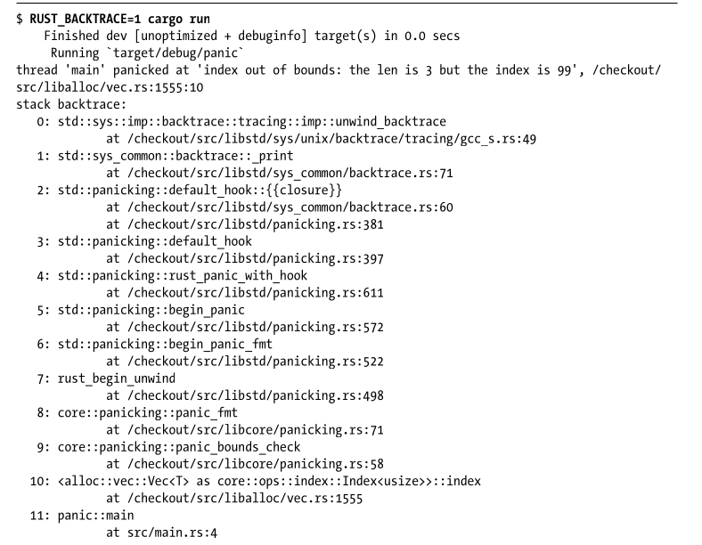
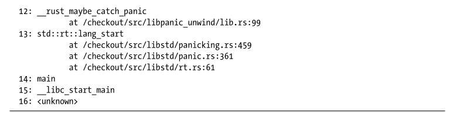

# Error Handling 

Rust requires you to acknowledge the possibility of an error and take some action before your code will compile.

Rust groups errors into two major categories:
- **Recoverable errors**: it's reasonable to report the problem to the user and retry the operation (eg. file not found);
- **Unrecoverable errors**: always symptoms of bugs, like trying to access a location beyond the end of the array;

Instead, it has the type `Result<T, E>` for recoverable errors and the `panic!` macro that stops execution when the program encounters an unrecoverable error.

## Unrecoverable Errors: the panic! macro

When the `panic!` macro executes, your program will print a failure message, unwind and clean up the stack, and then quit.

For example:
```rust
fn main() {
    panic!("crash and burn");
}
```

If you run this simple program will output:
```rust
$ cargo run
    Compiling panic v0.1.0 (file:///projects/panic)
    Finished dev [unoptimized + debuginfo] target(s) in 0.25 secs
    Running 'target/debug/panic'

thread 'main' panicked at 'crash and burn', src/main.rs:2:4
note: Run with 'RUST_BACKTRACE=1' for a backtrace.
```
Showing the error message we defined earlier but also the line and file on which our program panicked.

### Using a panic! Backtrace

Let’s look at another example to see what it’s like when a panic! call comes from a library because of a bug in our code instead of from our code calling the macro directly.

```rust
fn main() {
    let v = vec![1, 2, 3];

    v[99];
}
```
As you can see we're trying to access the 100-th element of a 3-element array resulting in the following compile-time error:
```rust
$ cargo run
    Compiling panic v0.1.0 (file:///projects/panic)
    Finished dev [unoptimized + debuginfo] target(s) in 0.27 secs
    Running 'target/debug/panic'
thread 'main' panicked at 'index out of bounds: the len is 3 but the index is 99', /checkout/src/liballoc/vec.rs:1555:10
note: Run with 'RUST_BACKTRACE=1' for a backtrace.
```

This error points at a file we didn’t write, 'vec.rs'. That’s the implementation of `Vec<T>` in the standard library.

The next note line tells us that we can set the `RUST_BACKTRACE` environment variable to get a backtrace of exactly what happened to cause the error. \
A backtrace is a list of all the functions that have been called to get to
this point. 

Backtraces in Rust work as they do in other languages: the key
to reading the backtrace is to start from the top and read until you see files
you wrote. That’s the spot where the problem originated.

Let’s try getting a backtrace by setting the `RUST_BACKTRACE` environment variable to any value
except 0:




In the output, line 11 of the backtrace points to the line
in our project that’s causing the problem: line 4 of 'src/main.rs'. \
If we don’t want our program to panic, the location pointed to by the first line mentioning a file we wrote is where we should start investigating.

When your code panics in the future, you’ll need to figure out what action the code is taking with what values to cause the panic and what the code should do instead.

## Recoverable Errors: Result

Most errors aren’t serious enough to require the program to stop entirely.
Sometimes, when a function fails, it’s for a reason that you can easily interpret
and respond to. For example, if you try to open a file and that operation fails
because the file doesn’t exist, you might want to create the file instead of terminating the process. 

Recall from “Handling Potential Failure with the Result Type” on
page 17 that the `Result` enum is defined as having two variants, `Ok` and
`Err`, as follows:
```rust
enum Result<T, E> {
    Ok(T),
    Err(E),
}
```
The `T` and `E` are generic type parameters. \
What you need to know is that `T` represents the type of the value that will be returned in a success case within the `Ok` variant, and `E` represents the type of the error that will be returned in a failure case within the `Err` variant.

Let’s call a function that returns a `Result` value because the function
could fail in this example:
```rust
use std::fs::File;

fn main() {
    let f = File::open("hello.txt");
}
```